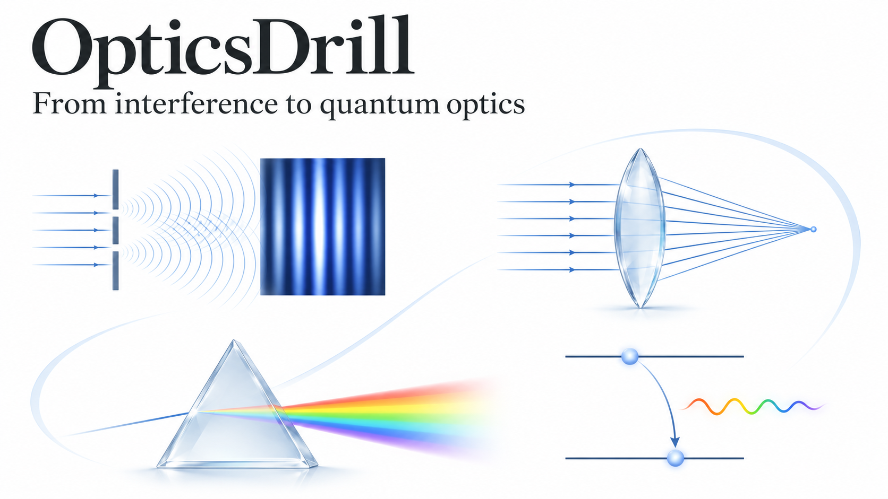
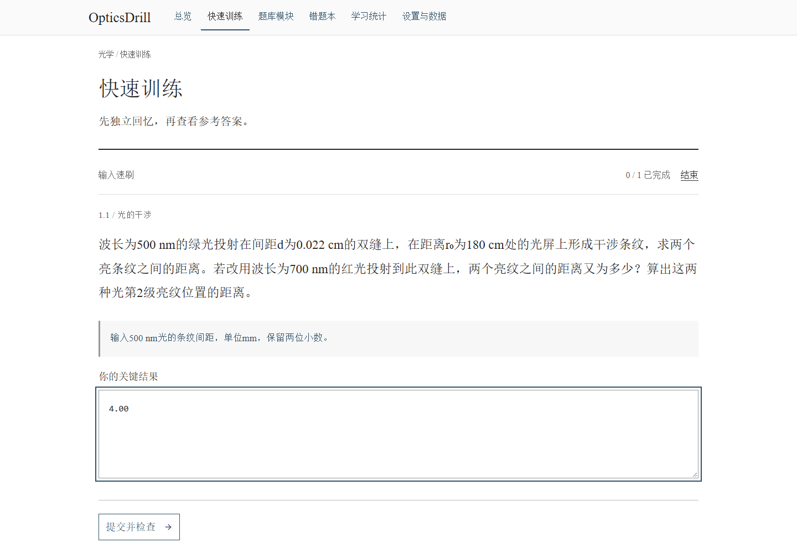
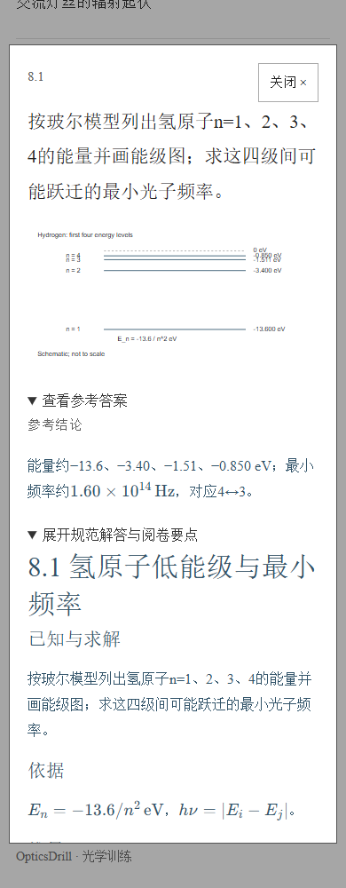
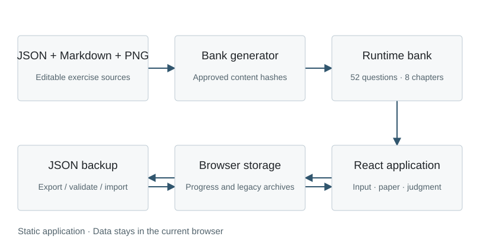

# OpticsDrill

[Practice online](https://hnnuyuxuan.github.io/OpticsDrill/) · [中文](README.md) · [Course IDs](docs/workspace.md) · [Content review](docs/content-notes.md)



A browser-based study app for **52 course-selected exercises** from *Optics Tutorial*, sixth edition, originally authored by Yao Qijun. It brings key-result checks, handwritten derivations, self-assessment, corrections and spaced review together. The interface and exercise content are in Chinese.

| Interference | Diffraction | Geometrical optics | Optical instruments | Polarization | Absorption, scattering & dispersion | Quantum nature of light | Modern optics |
|---:|---:|---:|---:|---:|---:|---:|---:|
| 11 | 8 | 8 | 7 | 6 | 4 | 5 | 3 |

### A complete practice loop

1. Choose exercises by chapter, ID, tag or learning status in the overview.
2. **Quick input** checks specified key results. **Paper practice** supports full derivations and self-assessment. **Concept judgment** tests assumptions, signs and common misconceptions.
3. Correct an unsuccessful answer and study the solution: givens and goals, governing principles, derivation, result, and marking points. Continue with wrong-answer retries and due reviews.
4. Review statistics and export a JSON backup when transferring progress to another browser or device. Import it into the same app.



Recorded from the production preview: exercise 1.1, an input of 4.00, correction, solution review, wrong-answer practice, and a successful retry with 4.09. Automated checks cover key results; learners assess full physical reasoning against the marking points.

### Desktop and mobile




Progress and drafts stay in this browser's local storage and survive refreshes. OpticsDrill uses its own app identity. Export a backup before clearing browser data or changing devices. This static app does not upload learning records to a server.

### Run and maintain

Use Node.js 24 and the committed lockfile:

```sh
npm ci
npm run figures
npm run bank
npm run lint
npm test
npm run build
npm run preview
```

Open `http://127.0.0.1:5173/OpticsDrill/` for the production preview. For development, run `npm run dev` and use the address printed in the terminal.



Edit prompts and checks in `sources/questions.json`, and full solutions in `sources/solutions/*.md`. The generator follows the exercise list in `sources/meta.json`; chapter structure and counts come from that list. `scripts/figures.mjs` creates the original SVG diagrams, and KaTeX renders mathematics. Increment `bankVersion` and solution `revision` according to the meaning of a change, preserving source-identity compatibility rules.

GitHub Actions checks generated-file consistency, formatting, tests and the production build before deploying to `/OpticsDrill/`. Deployment follows the [Vite guide](https://vite.dev/guide/static-deploy) and [GitHub Pages workflow guide](https://docs.github.com/en/pages/getting-started-with-github-pages/using-custom-workflows-with-github-pages).

### Sources and license

See the [maintenance notes](docs/workspace.md) for the exact selected IDs and printed-page attribution. Public prompts are paraphrased and key diagrams are original SVGs. Textbook scans, original exercise crops and source HTML/Markdown remain private in the ignored local folder `.local/materials/`. Printed-page numbers and PDF page indices are recorded separately.

Adapted from [ElectromagnetismDrill](https://github.com/HNNUYUXUAN/ElectromagnetismDrill/tree/e33c9213ac42ec4f0c0ab5dc5e7ee635dda6eca3) at `e33c9213ac42ec4f0c0ab5dc5e7ee635dda6eca3`, retaining its MIT attribution and lockfile. Application code is [MIT licensed](LICENSE). Textbook and source-exercise rights remain with their respective owners. The covers are ChatGPT-generated conceptual illustrations; scientific and architecture diagrams are editable SVGs. See [media notes](docs/media.md).
