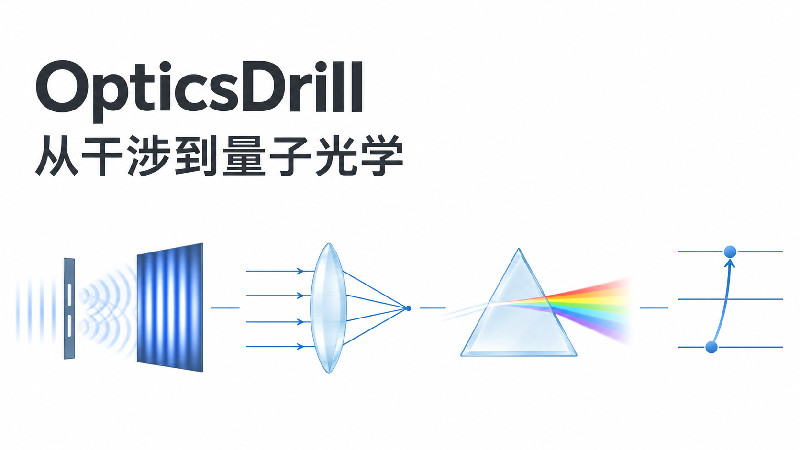
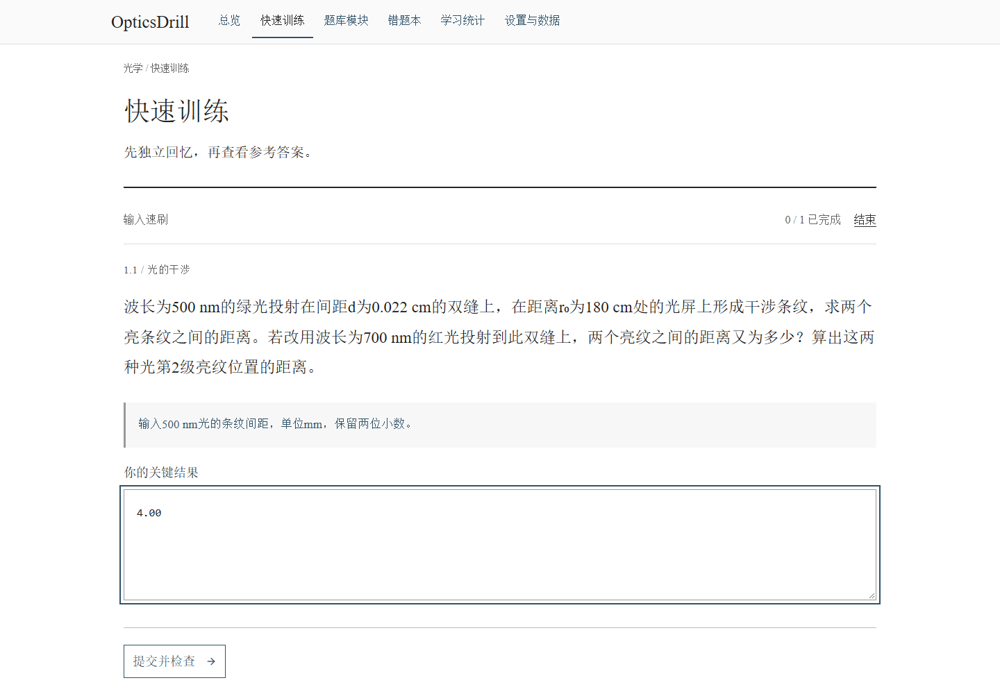
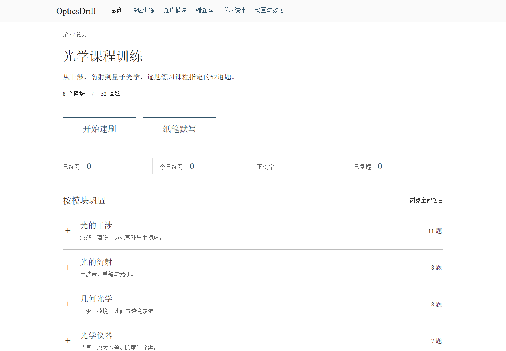
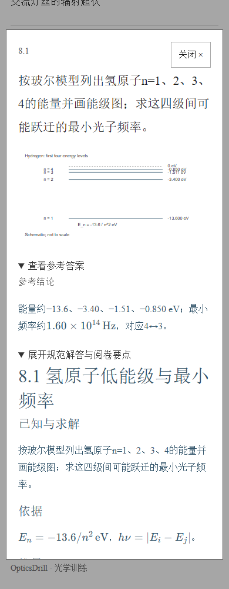
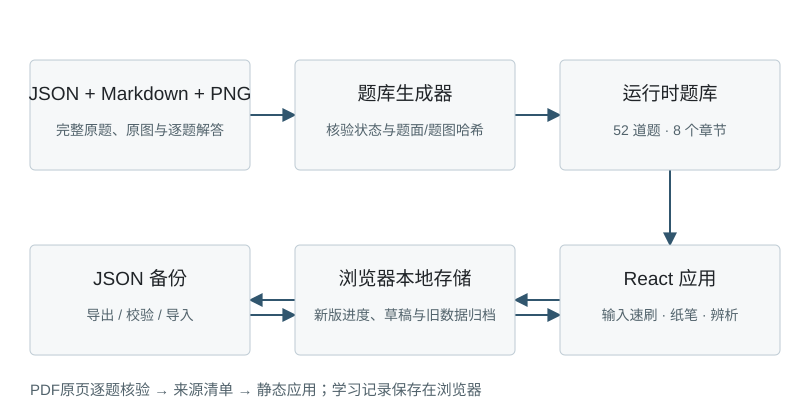

# OpticsDrill · 光学刷题

[在线练习](https://hnnuyuxuan.github.io/OpticsDrill/) · [English](README.en.md) · [课程题号](docs/workspace.md) · [校核说明](docs/content-notes.md)



围绕姚启钧原著《光学教程》（第六版）的课程指定 **52题**，把关键结果输入、纸笔推导、自评订正与间隔复习放进同一个浏览器应用。覆盖8章；界面与题目内容为中文。

| 干涉 | 衍射 | 几何光学 | 光学仪器 | 偏振 | 吸收、散射与色散 | 光的量子性 | 现代光学 |
|---:|---:|---:|---:|---:|---:|---:|---:|
| 11 | 8 | 8 | 7 | 6 | 4 | 5 | 3 |

### 从一题到一轮复习

1. 在总览按章节、题号、标签或掌握情况选择题目。
2. **输入速刷**核对指定关键结果；**纸笔默写**对照完整解答自评；**辨析训练**检查条件、符号与常见误区。
3. 输入错误后订正并查看“已知与求解—依据—推导—结果—阅卷要点”，再加入错题回炉与到期复习。
4. 在统计页查看训练情况；需要迁移设备时导出JSON备份，再从同一应用导入。



动图来自实际生产预览：第1.1题输入4.00、订正、查看解答、进入错题回炉、重练并输入4.09。关键结果匹配帮助快速反馈，完整物理推导由学习者按阅卷要点自评。

### 桌面与手机





学习记录与草稿保存在当前浏览器的本地存储，刷新可恢复；应用使用独立的OpticsDrill身份。浏览器清理存储或更换设备前请导出备份。站点为静态应用，学习记录不上传服务器。

### 本地运行与维护

使用Node.js 24及仓库锁文件：

```sh
npm ci
npm run figures
npm run bank
npm run lint
npm test
npm run build
npm run preview
```

生产预览地址为 `http://127.0.0.1:5173/OpticsDrill/`。开发时运行 `npm run dev`，打开终端显示的地址。



题面与校验规则维护于 `sources/questions.json`，完整解答维护于 `sources/solutions/*.md`。生成器依据 `sources/meta.json` 的题目清单生成运行时题库，章节与数量来自清单。自绘题图由 `scripts/figures.mjs` 生成，公式使用KaTeX。更新题源或解答时，按含义递增 `bankVersion` 与解法 `revision`，保留题源身份的兼容更新语义。

GitHub Actions执行生成差异检查、格式检查、测试与构建，再部署到Pages项目子路径 `/OpticsDrill/`。配置依据[Vite部署说明](https://vite.dev/guide/static-deploy)与[GitHub Pages工作流说明](https://docs.github.com/en/pages/getting-started-with-github-pages/using-custom-workflows-with-github-pages)。

### 题源与许可

课程指定范围与教材印刷页码见[材料维护说明](docs/workspace.md)。公开题面经过转述，关键示意图为自绘SVG；教材扫描、原题切片与原始HTML/Markdown材料保留在本机忽略目录 `.local/materials/`，作为私有校对证据。印刷页码与PDF页序分别记录。

应用底座改编自[ElectromagnetismDrill](https://github.com/HNNUYUXUAN/ElectromagnetismDrill/tree/e33c9213ac42ec4f0c0ab5dc5e7ee635dda6eca3)，固定提交 `e33c9213ac42ec4f0c0ab5dc5e7ee635dda6eca3`，保留其MIT署名与锁文件。代码采用[MIT许可](LICENSE)。教材及原题权利归原权利人；封面为ChatGPT生成的概念插画，科学题图与架构图为可编辑SVG。详见[展示素材说明](docs/media.md)。
