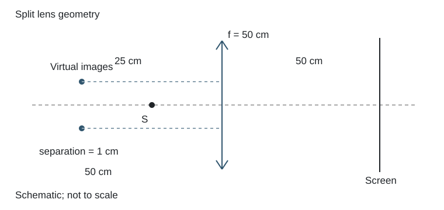

# 1.19 切割透镜产生的相干虚源

### 已知与求解

焦距50 cm的会聚透镜切去中央宽1 cm条带后，将两半相向合拢。点源在组合对称轴上、距透镜25 cm，屏在另一侧50 cm。对692 nm光求条纹间距及形状。

### 依据

$1/f=1/u+1/v$；偏心量$a$给出$y_i=(1-m)a$；$\Delta x=\lambda L/d$。

### 推导

每半透镜的轴向物距$u=25\,\mathrm{cm}$、焦距$f=50\,\mathrm{cm}$，于是
$$\frac1v=\frac1{50}-\frac1{25}=-\frac1{50},\qquad v=-50\,\mathrm{cm},\qquad m=-v/u=2.$$
去掉中央$1\,\mathrm{cm}$后将两半相向合拢，各自光轴相对新对称轴位于$a=\pm0.5\,\mathrm{cm}$。物点位于$y=0$，故每个虚像的横坐标
$$y_i=a+m(0-a)=(1-m)a=-a.$$
两虚像相距$d=1\,\mathrm{cm}$，均在透镜物侧$50\,\mathrm{cm}$。屏在另一侧$50\,\mathrm{cm}$，所以虚源到屏距离为$L=100\,\mathrm{cm}=1\,\mathrm m$。
$$\Delta x=\frac{\lambda L}{d}=\frac{692\times10^{-9}\times1}{0.01}=6.92\times10^{-5}\,\mathrm m=0.0692\,\mathrm{mm}.$$
在两半出射光重叠的近轴区域形成等间距直条纹，条纹方向垂直于两虚源的连线。原扫描清楚给出中央条带宽$1\,\mathrm{cm}$，本题可给确定数值。

### 结果

两虚源相距1 cm，到屏距离1 m；间距0.0692 mm，为近轴等间距直纹。

### 阅卷要点

- 写明本题的模型、符号与所求量。
- 条纹公式应使用虚源到屏的1 m距离。
- 展示推导与数值代入，核对单位、有效数字及适用条件。
- 两虚源相距1 cm，到屏距离1 m；间距0.0692 mm，为近轴等间距直纹。

