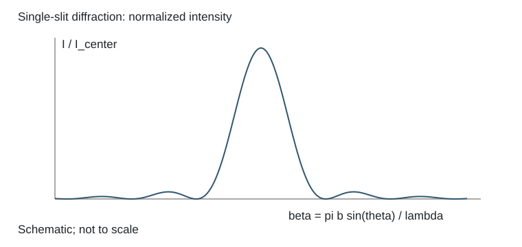

# 2.8 单缝次极大的重合波长

### 已知与求解

白光单缝衍射中，某波长的第三个次极大与600 nm光的第二个次极大重合。用精确条件求未知波长，并比较常用近似。

### 依据

$\tan\beta=\beta$；同角度下$\beta\lambda$固定，即$600\beta_2=\lambda\beta_3$。

### 推导

单缝归一化强度为
$$I/I_c=(\sin\beta/\beta)^2,\qquad\beta=\pi b\sin\theta/\lambda.$$
除中央极大外，次极大满足$\tan\beta=\beta$。第二、第三次极大的精确根为
$$\beta_2=7.72525183694,\qquad\beta_3=10.90412165943.$$
重合意味着观察角相同，因此$\beta\lambda$相同：
$$600\,\mathrm{nm}\times\beta_2=\lambda\beta_3.$$
所以
$$\lambda=600\frac{7.72525183694}{10.90412165943}\,\mathrm{nm}=425.0824823\,\mathrm{nm}\approx425.1\,\mathrm{nm}.$$
若以半整数近似$\beta_2\approx5\pi/2$、$\beta_3\approx7\pi/2$，得到$428.6\,\mathrm{nm}$，这是近似值；应与精确次极大条件的数值结果分开。

### 结果

精确解425.0825 nm（取425.1 nm）；半整数近似428.6 nm。

### 阅卷要点

- 写明本题的模型、符号与所求量。
- 同一狭缝同一方向上β与波长成反比。
- 展示推导与数值代入，核对单位、有效数字及适用条件。
- 精确解425.0825 nm（取425.1 nm）；半整数近似428.6 nm。

