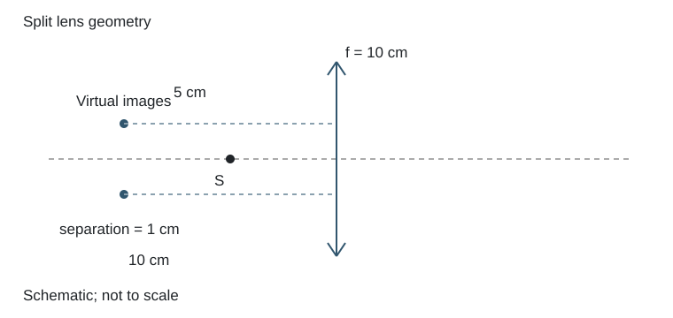

# 3.21 拼合半透镜的双像

### 已知与求解

焦距10 cm的会聚透镜切去中央宽1 cm条带，将剩余两半相向粘合。点源在组合对称轴上、距透镜5 cm，求两像的位置。

### 依据

每半透镜$s'=-10\,\mathrm{cm}$，$m=2$；偏心像坐标$y_i=(1-m)a$。

### 推导

原会聚透镜焦距 `f=10 cm`，物点距组合透镜对称轴 `5 cm`。中央条带宽度 `1 cm` 被切去后，上、下两部分 A、B 相向粘合；两部分的光轴相对组合透镜的对称轴分别偏移 `−0.5 cm` 与 `+0.5 cm`。

对每一部分，物距 `s=5 cm`：

$$

\frac1{s'}=\frac1{10}-\frac15=-\frac1{10},
\qquad s'=-10\text{ cm}.

$$

故两部分各自形成物侧虚像。对光轴偏移量为 `a` 的透镜，物点位于组合对称轴 `y=0`，放大率

$$

m=-\frac{s'}s=2,
\qquad y'=a+m(0-a)=-a.

$$

上半部分 `a=−0.5 cm`，其像在 `y′=+0.5 cm`；下半部分 `a=+0.5 cm`，其像在 `y′=−0.5 cm`。两像轴向位置相同，横向间隔 `1 cm`。

**答案：** 形成两个正立虚像，均在透镜物侧 `10 cm` 处，分别位于组合对称轴上方、下方 `0.5 cm`，两像相距 `1 cm`。两像是由 A、B 两个偏心透镜部分分别形成的。

### 结果

两正立虚像均在物侧10 cm，横向位于轴两侧各0.5 cm，相隔1 cm。

### 阅卷要点

- 写明本题的模型、符号与所求量。
- 两半透镜各自的光轴偏移会使虚像横向分离。
- 展示推导与数值代入，核对单位、有效数字及适用条件。
- 两正立虚像均在物侧10 cm，横向位于轴两侧各0.5 cm，相隔1 cm。

