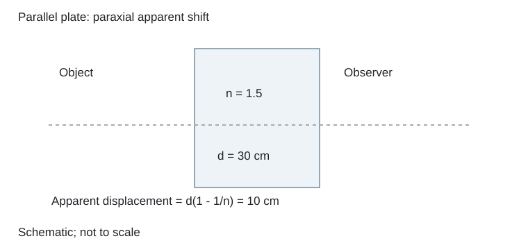

# 3.3 玻璃平板的视深位移

### 已知与求解

厚30 cm、折射率1.5的平行玻璃板置于眼睛与物体之间。近轴观察时，求物体的像相对物体沿视线移动的距离。

### 依据

$\Delta=d(1-1/n)$，采用近轴视深关系。

### 推导

**已知**：平板折射率 `n=1.5`，厚度 `d=30 cm`。求物像轴向间距 `d₂`。

近轴光线通过平行平板后出射方向与入射方向平行。把板内光程换算为空气中的等效距离，板厚 `d` 对应的视深为 `d/n`，因此物像沿轴向的位移为

$$

 d_2=d-\frac dn=d\left(1-\frac1n\right)
 =30\left(1-\frac1{1.5}\right)=10\text{ cm}.

$$

**答案：** $d_2=10\text{ cm}$。像向观察者方向移动，图中 `P′Q′` 位于 `PQ` 与平板之间。

### 结果

像向观察者移动10 cm。

### 阅卷要点

- 写明本题的模型、符号与所求量。
- 平行平板出射光线仍与入射光线平行。
- 展示推导与数值代入，核对单位、有效数字及适用条件。
- 像向观察者移动10 cm。

