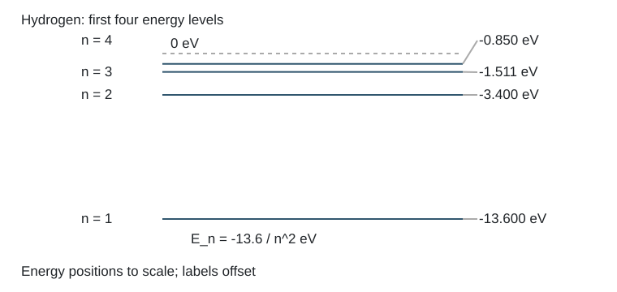

# 8.1 氢原子低能级与最小频率

### 已知与求解

（1）试计算氢原子最低的四个能级的能量大小，并把它们画成能级图；（2）试计算这四个能级之间跃迁的最小的频率是多少？

### 依据

$E_n=-13.6/n^2\,\mathrm{eV}$，$h\nu=|E_i-E_j|$。

### 模型与约定

- 使用教科书玻尔能级近似，未计精细/超精细结构。
- 0 eV为电离极限；能级图为解答图，不能标为教材原题附图。

### 推导

**已知与所求**：氢原子玻尔模型，求 $n=1,2,3,4$ 的能量及四能级间最小跃迁频率。

**原理**：氢原子能级

$$

E_n=-\frac{13.6}{n^2}\ \mathrm{eV}.

$$

**计算**：

- 主量子数 $n$：1；能量 $E_n$（eV）：$-13.600$；能量（J）：$-2.179\times10^{-18}$
- 主量子数 $n$：2；能量 $E_n$（eV）：$-3.400$；能量（J）：$-5.447\times10^{-19}$
- 主量子数 $n$：3；能量 $E_n$（eV）：$-1.511$；能量（J）：$-2.421\times10^{-19}$
- 主量子数 $n$：4；能量 $E_n$（eV）：$-0.8500$；能量（J）：$-1.362\times10^{-19}$

能级图（能量向上增加）：

能级的相对位置见下方按能量刻度绘制的SVG示意图。

四个能级之间最小的能量间隔是相邻的最高两能级 $n=4$ 与 $n=3$：

$$

\Delta E_{\min}=E_4-E_3\ \text{的绝对值}=0.6611\ \mathrm{eV}
=1.060\times10^{-19}\ \mathrm J.

$$

由 $\Delta E=h\nu$，

$$

\nu_{\min}=\frac{\Delta E_{\min}}h
=1.599\times10^{14}\ \mathrm{Hz}.

$$

**结论**：最低四个能级依次为 $-13.600$、$-3.400$、$-1.511$、$-0.8500\ \mathrm{eV}$；最小跃迁频率约为 $1.60\times10^{14}\ \mathrm{Hz}$，对应 $4\leftrightarrow3$ 跃迁。

### 结果

能量约−13.6、−3.40、−1.51、−0.850 eV；最小频率约$1.60\times10^{14}\,\mathrm{Hz}$，对应4↔3。

### 阅卷要点

- 按原题回答全部所求，给出必要推导、符号约定和单位。
- 这四级中最小能隙出现在n=3与n=4之间。
- 能量约−13.6、−3.40、−1.51、−0.850 eV；最小频率约$1.60\times10^{14}\,\mathrm{Hz}$，对应4↔3。

